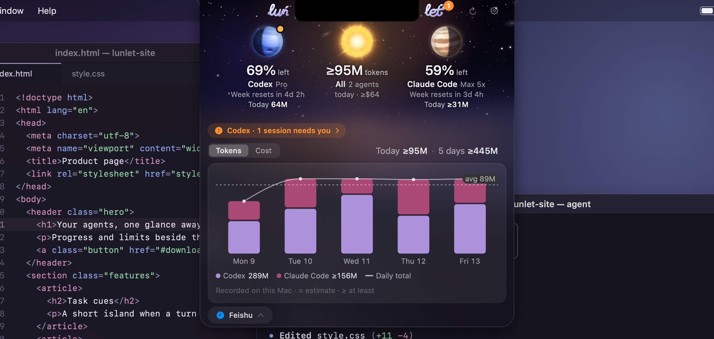
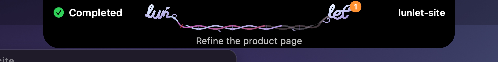
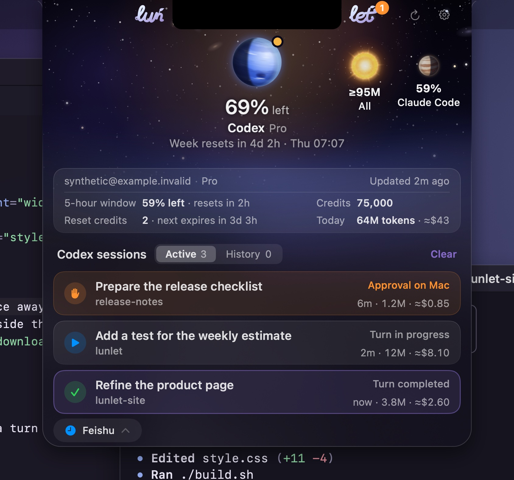
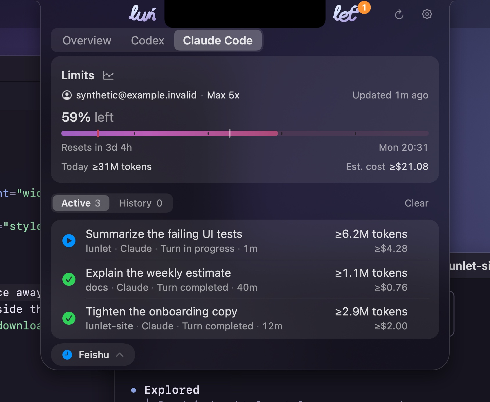
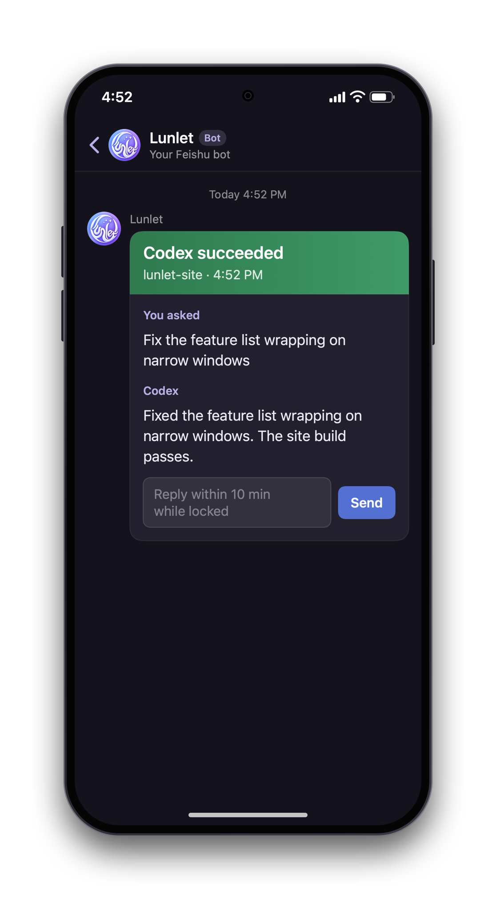
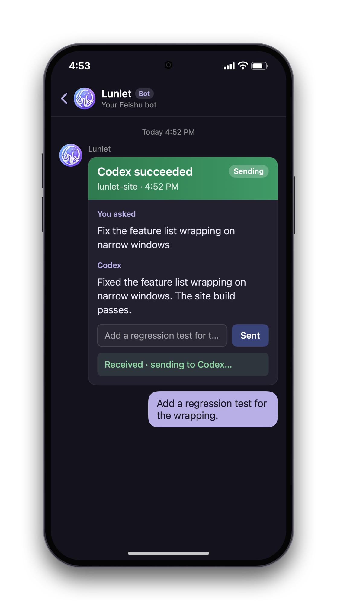
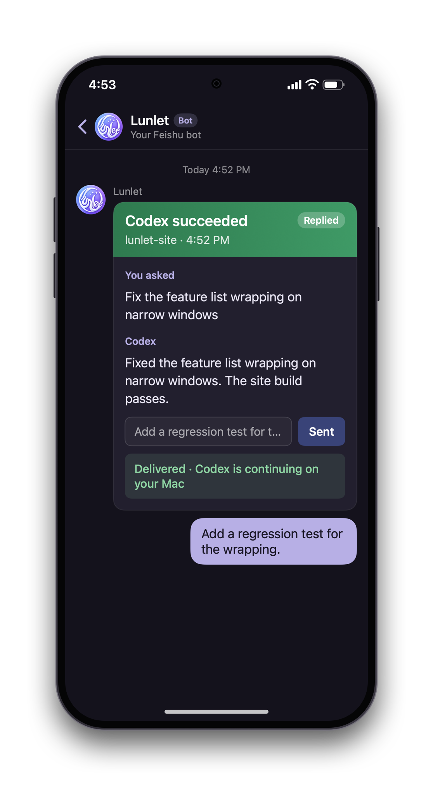

<h1 align="center">Lunlet</h1>

<p align="center">Codex と Claude Code を、ノッチのそばに。</p>

<p align="center">
  <a href="README.md">English</a> · <a href="README.zh-CN.md">简体中文</a> · <strong>日本語</strong>
</p>

<p align="center">
  <a href="https://github.com/yukunlabs/lunlet/releases/latest"></a>
  
  <a href="LICENSE"></a>
</p>

<p align="center">
  
</p>

Lunlet はノッチの横に常駐し、コーディングエージェントが今なにをしているか、プランの上限まであとどれだけ使えるかを表示します。Mac をロックして席を離れても、ターンが終わるたびにスマートフォンへ通知が届き、ひとこと返信すれば同じセッションが続きます。

手元の Mac で動作し、自前のサーバーも、アナリティクスやテレメトリもありません。[1 分間の紹介動画を見る](https://yukunlabs.github.io/lunlet/#film)。

<sub>画像と紹介動画は、Lunlet の実際の画面にダミーデータを表示して作成したものです。</sub>

## 機能

### セッション

<p align="center">
  
</p>

ローカルの Codex と Claude Code のセッションをすべて、どのターミナルやエディターで動いていても 1 つの一覧にまとめ、直近のプロンプト、状態、トークン数を表示します。ターンの開始時と終了時には、ノッチに小さなアイランドが現れます。

### 上限と使用量

<p align="center">
  
  
</p>

各エージェントの週間上限は、ノッチの横に表示されます。パネルを開くと、Codex の 5 時間枠とクレジット、上限に達しそうな時期の見込み、日ごとのトークン使用量と API 価格での概算コストも確認できます。

### スマートフォンへの通知

<p align="center">
  
  
  
</p>

Mac がロックされている間、ターンが終わるたびに、自分の Feishu（Lark）、Slack または Telegram のボットに通知が届きます。スマートフォンから 1 回返信すると、同じセッションが続きます。実行の承認は、これまでどおり Mac 上で行います。設定方法は[メッセージング設定](docs/messaging.md)（英語）をご覧ください。

### そのほか

- ノッチのない Mac では、メニューバーのアイコンか、小さなデスクトップペットを使えます。
- Vine と Lantern のスキンは色を変えられ、[自作する](docs/skins.md)こともできます（英語）。

## インストール

1. [最新リリース](https://github.com/yukunlabs/lunlet/releases/latest)から `Lunlet-<version>-macos-arm64.dmg` をダウンロードして開き、Lunlet を「アプリケーション」にドラッグします。
2. Lunlet を開きます。現在は未署名のプレビュー版のため、初回のみ macOS で許可が必要です。macOS 15 以降では、警告で「完了」をクリックしてから、「システム設定」＞「プライバシーとセキュリティ」で「このまま開く」をクリックし、確認します。macOS 14 では Lunlet を右クリックして「開く」を選びます。
3. ノッチの両脇にある「lun」と「let」にポインターを合わせるとパネルをプレビューでき、クリックすると開いたままになります。

macOS 14 以降を搭載した Apple シリコンの Mac と、この Mac でサインイン済みの Codex または Claude Code が必要です。アップデートは Lunlet の中から行えます。

## プライバシー

- Lunlet は手元の Mac で動作し、自前のサーバーも、アナリティクスやテレメトリもありません。
- アクティビティと使用量を表示するために、Codex と Claude Code のローカルのセッション記録を読み取ります。Claude Code のログイン認証情報を読み取ることはありません。
- Claude Code を選択している間、Lunlet は Claude Code のユーザー設定にステータスラインと Stop フックを 1 つ追加します。Claude Code をオフにすると、フックは削除され、元のステータスラインに戻ります。
- 通知が送られるのは、Mac がロックされていて、ボットがペアリングされているときだけです。通知はそのメッセンジャーを経由して自分の個人チャットに届き、プロジェクト、セッションのタイトル、依頼内容の短い抜粋、エージェントの最終的な返答が含まれます。
- ボットのトークンは Mac 上の、自分のユーザーアカウントだけが読めるファイルに保存されます。

詳細は [docs/privacy.md](docs/privacy.md)（英語）をご覧ください。

## 現在の状況

Lunlet は初期段階の未署名プレビュー版です。スマートフォンからエージェントの質問に回答する機能、公証済みの配布版、Intel Mac、Linux、Codex と Claude Code 以外のエージェントには、まだ対応していません。これまでに検証した内容は [docs/feasibility.md](docs/feasibility.md)（英語）に記録しています。

## ソースからビルド

```sh
scripts/build-app.sh --preview
open .tmp/Lunlet.app
```

Swift 6.2 以降を含む Xcode Command Line Tools が必要です。コントリビュートする場合は、まず [CONTRIBUTING.md](CONTRIBUTING.md)（英語）をお読みください。

## ドキュメント

- [メッセージング設定](docs/messaging.md)と[カスタムスキン](docs/skins.md)
- [プライバシー](docs/privacy.md)と[セキュリティポリシー](SECURITY.md)
- [要件](docs/requirements.md)、[実現性の検証](docs/feasibility.md)、[リリース](docs/releases.md)
- [製品ページ](https://yukunlabs.github.io/lunlet/)

これらのドキュメントは現在のところ英語のみです。

## ライセンス

[0BSD](LICENSE)。サードパーティのライセンス表記は [NOTICE.md](NOTICE.md) にあります。

Codex、Claude、Feishu、Lark、Slack、Telegram は各所有者の商標です。Lunlet は独立したプロジェクトであり、これらの企業と提携しておらず、承認も受けていません。
