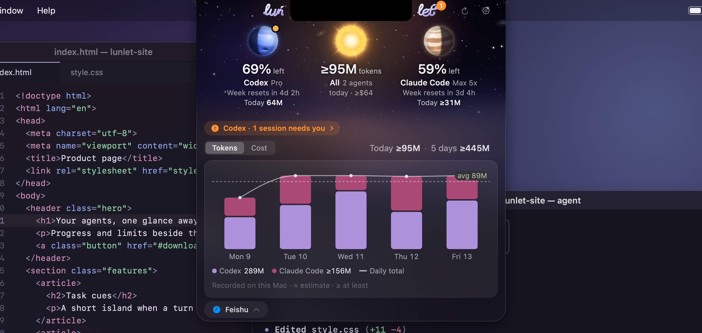
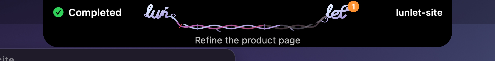
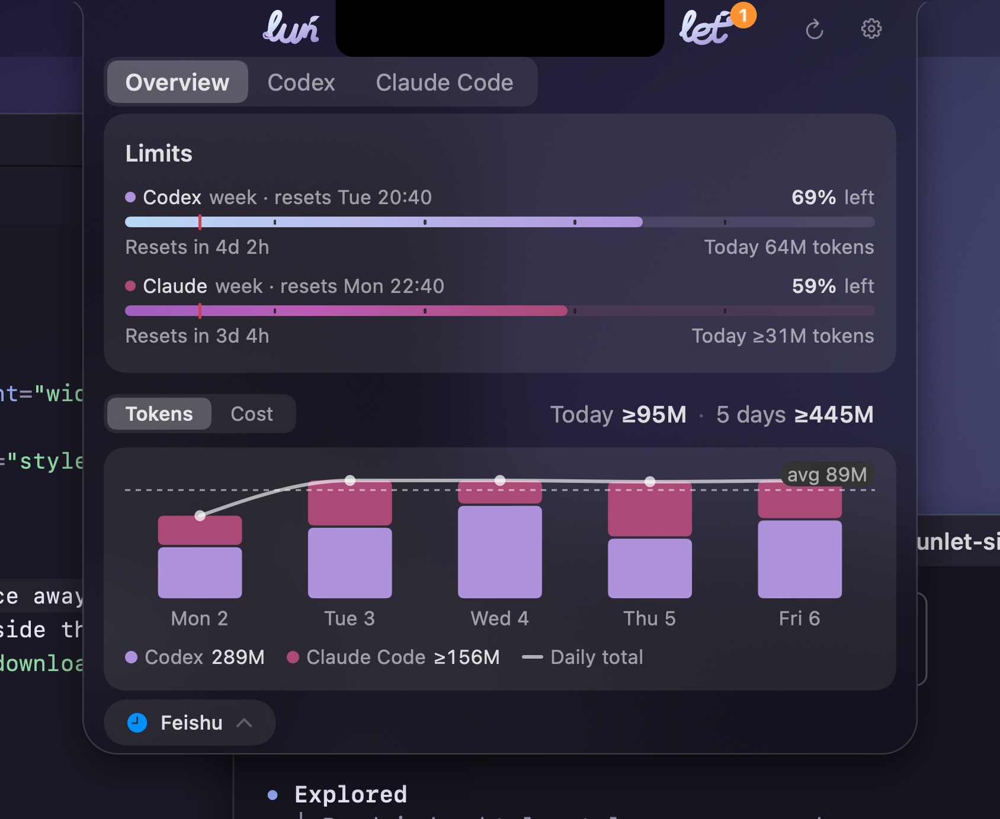
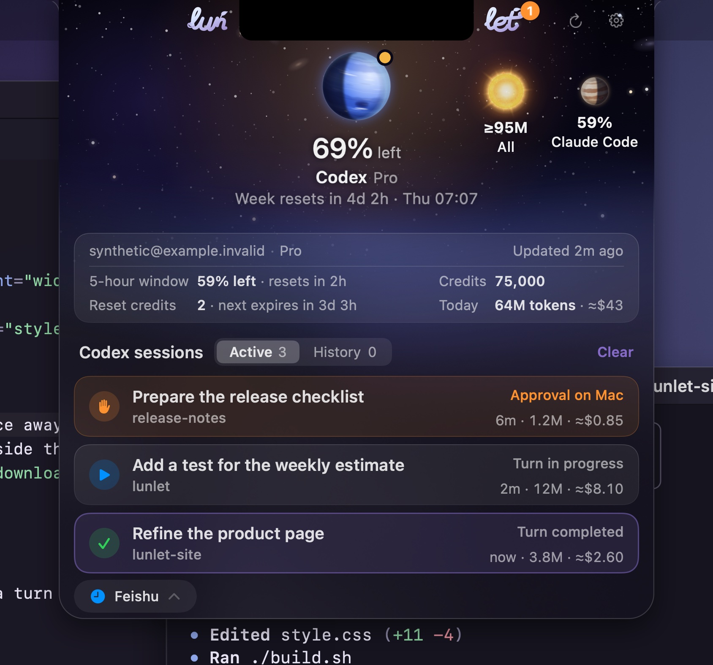
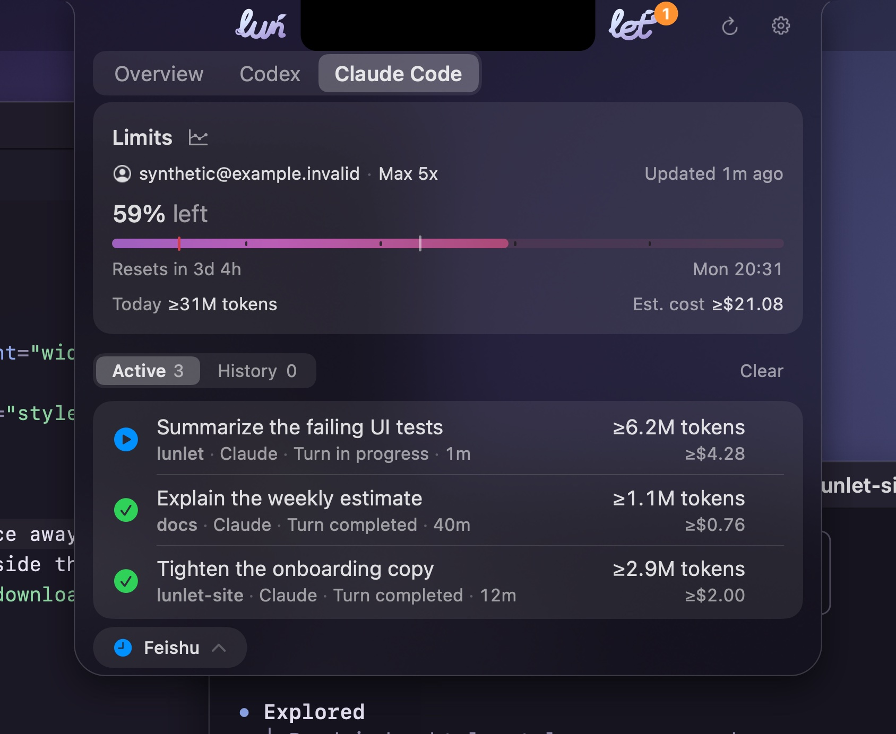
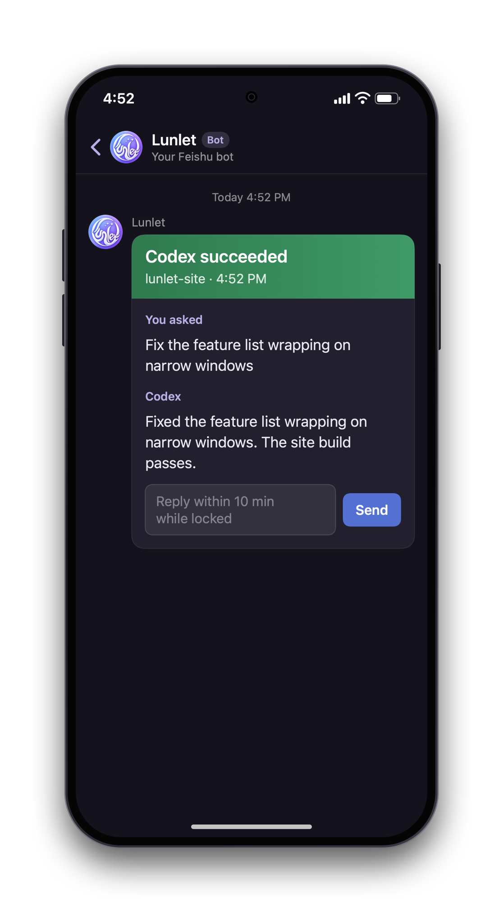
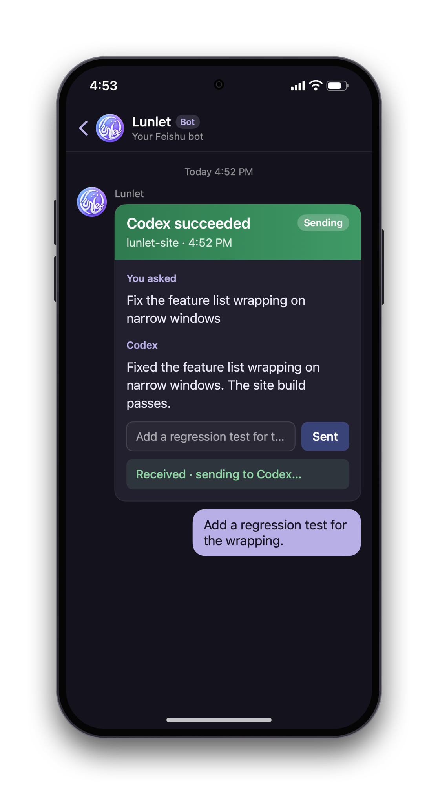
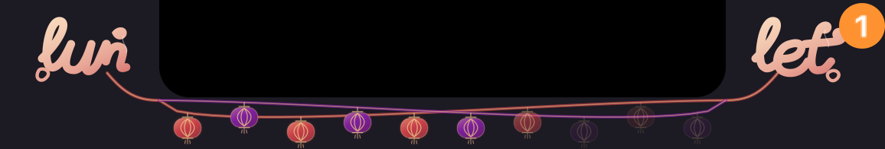

<h1 align="center">Lunlet</h1>

<p align="center"><strong>A quiet companion for your coding agents, right at the notch.</strong></p>

<p align="center">
  See what Codex and Claude Code are doing and how much of each plan is left, without switching windows.<br>
  While the Mac is locked, a finished turn reaches your phone, and one reply continues that session.
</p>

<p align="center">
  <a href="https://github.com/yukunlabs/lunlet/releases/latest"></a>
  
  <a href="LICENSE"></a>
  <a href="https://github.com/yukunlabs/lunlet/actions/workflows/validate.yml"></a>
</p>

<p align="center">
  <a href="#install"><strong>Install</strong></a> ·
  <a href="https://yukunlabs.github.io/lunlet/">Product page</a> ·
  <a href="https://yukunlabs.github.io/lunlet/#film">One-minute walkthrough</a> ·
  <a href="#privacy">Privacy</a>
</p>

<p align="center">
  
</p>

<p align="center"><sub>Every picture here is rendered from Lunlet's own interface with synthetic data by <code>scripts/render-site-assets.sh</code>, and so is the <a href="https://yukunlabs.github.io/lunlet/#film">walkthrough</a>, captions included.</sub></p>

## What it does

- **Shows every session.** Local Codex sessions (CLI, Codex App, editors) and Claude Code sessions, each with its latest prompt, status and tokens. A short island at the notch tells you when a turn starts or finishes.
- **Tracks what is left.** Each agent's weekly allowance sits beside the notch as a vine strand. The panel adds Codex's five-hour window and credits, a trend that estimates when you might run out, and daily token usage with an API-price estimate.
- **Reaches you when you step away.** While the Mac is locked, each finished turn goes to your own Feishu or Lark, Slack or Telegram bot. One reply from your phone continues that same session.
- **Stays on your Mac.** Lunlet has no servers, analytics or telemetry of its own, and execution approvals stay on your Mac. It is free and open source under [0BSD](LICENSE).

## Install

1. Download `Lunlet-<version>-macos-arm64.dmg` from the [latest release](https://github.com/yukunlabs/lunlet/releases/latest), open it and drag Lunlet to Applications.
2. Open Lunlet and allow it once. The download is an unsigned preview, signed ad hoc and not notarized: on macOS 15 and later, open it, choose Done, then System Settings › Privacy & Security › Open Anyway; on macOS 14, right-click Lunlet and choose Open.
3. Find "lun" and "let" beside the notch: hover to preview the panel, click to keep it open. To get notices on your phone, follow [messaging setup](docs/messaging.md).

You need macOS 14 or later on Apple silicon (the download is arm64 only; tested on macOS 27; a notched MacBook gives the full experience) and Codex (CLI or app) and/or Claude Code, signed in on this Mac.

Updates install from inside Lunlet and ask for nothing. Each release lists its files' SHA-256 checksums, its source tag and, in `manifest.json`, its signing and notarization status; release notes live in [docs/release-notes](docs/release-notes). To build it yourself, see [Build from source](#build-from-source).

## A closer look

### At the notch

<p align="center">
  
</p>

"lun" and "let" sit beside the notch, joined by one vine strand per agent that shows how much of its weekly allowance is left. Hover to preview the panel, click to keep it open. Macs without a notch can use a menu-bar entry instead.

<p align="center">
  
</p>

A short island at the notch tells you when a turn starts or finishes; open the panel right after and it shows that conversation.

### Sessions, limits and usage

<p align="center">
  
  
  
</p>

- **Sessions at a glance.** Active and History lists for local Codex sessions (CLI, Codex App, editors) and Claude Code sessions, with each session's latest prompt, status and tokens.
- **Limits.** Codex's weekly allowance, or the longer window its plan reports instead, with its five-hour window, credits and reset credits. Claude Code's weekly limit through a status line Lunlet adds to Claude Code automatically (turning Claude Code off in Settings restores your previous one exactly). A trend estimates when you might run out, the menu-bar entry can show the allowance closest to running out, and a macOS notification can tell you when one runs low or resets (off until you turn it on).
- **Usage.** Daily token usage per agent, with a cost figure that is an API-price estimate, never your bill.

### While you are away

<p align="center">
  
  
  
</p>

While the Mac is locked and awake, each finished turn reaches the bot and private chat you paired, on Feishu or Lark, Slack or Telegram, with its outcome, your request and the agent's reply. A Codex notice takes one reply: from the Feishu card's reply box, Telegram's Reply button or the Slack thread, your reply continues that same session as its next turn, never a new one, once, within ten minutes and while the Mac stays locked. The notice is then rewritten in place with the reply's progress: received, sent, delivered, or why it was not sent. Execution approvals stay on your Mac.

#### Phone replies for Claude Code

Claude Code has no command that queues a message into a running session, so Lunlet uses Claude Code's Stop hook: while Claude Code is a selected agent, Lunlet adds one `Stop` entry to Claude Code's user settings (and removes exactly that entry when you turn Claude Code off or press Disconnect in Settings › Agents). Nothing else is needed: no flag, plugin or confirmation, in any terminal or editor. When a turn of a Claude Code session ends while your Mac is locked, the hook keeps that turn open for one phone reply, which continues the same conversation as your next message; when you unlock, it lets go at once. Settings › Agents says so beside the Claude Code switch and shows a note only if the hook could not be added.

### Three ways in, and yours to shape

<p align="center">
  
</p>

- **Three ways in.** The widget beside the notch, a menu-bar item, or a small desktop dog that sits on every Space, shows what your agents are doing (asleep, idle, working, done, waiting for you) and opens the panel as its speech bubble. Bring your own pet instead: a pack in Codex's format (`pet.json` beside a sprite sheet) from `~/.codex/pets` or Lunlet's own pets folder plays its idle, running, waiting and review rows for the same states.
- **Make it yours.** Vine and Lantern skins in any color, declarative [custom skins](docs/skins.md), your own pet, and a panel of dark frosted glass under a small night sky, with one planet per agent whose lit side shows how much of its allowance is left.

## Status

Lunlet is an unsigned preview.

- **Works locally:** Codex and Claude Code observation, limits and usage.
- **Verified on the maintainer's devices:** notices to a locked Mac's paired Feishu, Telegram or Slack chat, and one reply per notice that continues the same Codex session. Claude Code sessions take one reply per notice through Lunlet's Stop hook, verified with a phone reply into a held session on the maintainer's Mac.
- **Still open:** Feishu cards have not yet been reviewed in the phone app, and an in-app update from the first version is accepted when the second one ships.

### Not yet available

- Answering an agent's question from your phone, and more than eight phone replies in a row to one Claude Code turn without a typed prompt (Claude Code's own cap).
- A notarized download (the current one is an unsigned preview). Intel Macs. Feishu cards reviewed in the phone app.
- Linux, Cursor and other agents.

## Privacy

- Lunlet runs on your Mac and has no servers, analytics or telemetry of its own.
- It reads Codex's and Claude Code's local session records and transcripts to show activity and usage, including your latest request and the agent's final reply for each finished turn.
- A completion notice, sent only while the Mac is locked and a bot is paired, goes through that messaging provider to your private chat. It carries the project, agent and session title, an excerpt of your latest request (about 140 characters) and the agent's final reply, shortened only to fit the messenger. Secret-looking values and hidden reasoning are removed and home folders shortened, but no filter catches everything; tool output and the rest of the conversation are never sent.
- Codex limits come from Codex's own account interface on this Mac. Claude Code limits come only from Lunlet's status line in Claude Code, added while Claude Code is selected and removed, restoring your previous one, when you turn Claude Code off; the account email and plan come from Claude Code's local profile. Lunlet never reads Claude Code login credentials.
- A reply from Feishu, Slack or Telegram is passed to that session's own Codex with `codex queue` and only after Lunlet confirms the session is still open and idle; the session keeps its sandbox and approval settings. The reply text is briefly visible to your other processes as a command argument. A reply to a Claude Code session is written to a file in Lunlet's own folder and handed to that session by the hook helper Claude Code ran inside it, as the documented hook feedback that continues the turn under the session's existing permission mode; Lunlet never answers permission prompts.
- Messaging credentials are stored on your Mac in `~/Library/Application Support/com.lunlet/credentials`, in files only your user account can read, sealed with a key bound to this Mac and your account (not in the Keychain, so updates never ask for authorization). A copy of a file on another Mac or account cannot be opened, and a backup or disk scan shows no token; a program running as you could still read them, as it could read Codex's own credential file. Moving to a new Mac means connecting the channel again.
- Errors are also kept in a small local log at `~/Library/Logs/Lunlet` (no content or identifiers; it rotates at 256 KB and keeps one previous file, so about 512 KB at most; never uploaded); Settings › About shows it in Finder.
- Release builds check for updates about once a day with [Sparkle](https://sparkle-project.org); the request identifies only Lunlet's and Sparkle's versions, with no system profile, and nothing is downloaded until you choose Install. Turn the checks off in Settings › About. `--preview` builds never check.

## Build from source

You need Xcode Command Line Tools with Swift 6.2 or later. From a checkout of this repository:

```sh
scripts/build-app.sh --preview
open .tmp/Lunlet.app
```

`--preview` produces an ad hoc–signed build for your own Mac. The downloadable preview is also signed ad hoc, so macOS asks to allow it on first open; updates ask for nothing, because your bot connection is kept in a file only your user can read rather than in the Keychain. A Developer ID-signed, notarized release is a later step. See [release preparation](docs/releases.md). To connect a messaging bot, follow [messaging setup](docs/messaging.md).

## Development

Lunlet is a Swift package (SwiftUI and AppKit) with separate modules for the core, Codex, Claude Code, Feishu, messaging, secure storage and the desktop app.

```sh
scripts/test-core.sh all                      # default suite: every module in turn
scripts/test-core.sh desktop                  # one module: core, codex, claude, feishu, messaging, storage, desktop
LUNLET_TEST_PANEL=1 scripts/test-core.sh --filter PanelPlacementTests   # native window checks
python3 scripts/check_traceability.py         # story references, licensing headers, language
```

Every change traces to a confirmed user story in [the requirements](docs/requirements.md). Start with [Contributing](CONTRIBUTING.md); repository conventions are in [AGENTS.md](AGENTS.md). To follow diagnostics, which carry no content or identifiers, run `log stream --style compact --predicate 'subsystem == "com.lunlet"'`.

## Documentation

- [Requirements](docs/requirements.md): user stories, acceptance criteria and release scope.
- [Feasibility](docs/feasibility.md): technical evidence and open validation gates.
- [Design notes](docs/design.md): presentation rules and algorithm details the stories rely on.
- [Messaging setup](docs/messaging.md) and [custom skins](docs/skins.md).
- [Release preparation](docs/releases.md): packaging, signing, the product page and how releases are iterated.
- [Product page](https://yukunlabs.github.io/lunlet/) with the one-minute walkthrough.
- [Contributing](CONTRIBUTING.md), [code of conduct](CODE_OF_CONDUCT.md) and [security policy](SECURITY.md).

## Feedback

Found a bug or missing something? Use the [Bug report or Feature request form](https://github.com/yukunlabs/lunlet/issues/new/choose); security reports follow the [security policy](SECURITY.md). If Lunlet is useful to you, a star helps other people find it.

## License

[0BSD](LICENSE): free for everyone to use, copy, modify and distribute. Third-party notices are in [NOTICE.md](NOTICE.md).

Codex, Claude, Feishu, Lark, Slack and Telegram are trademarks of their respective owners. Lunlet is an independent project and is not affiliated with or endorsed by them.
