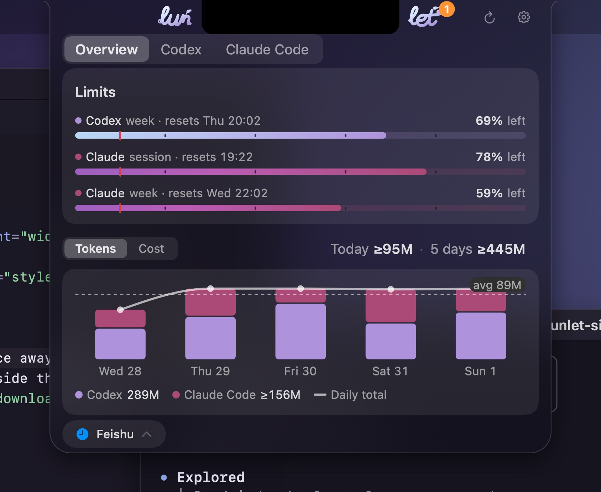
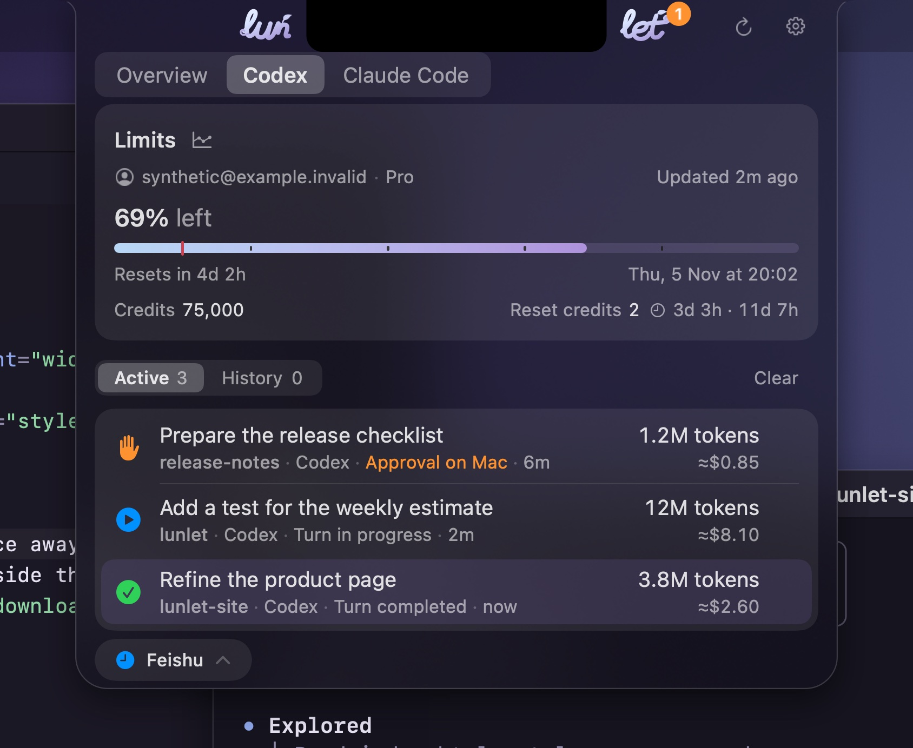
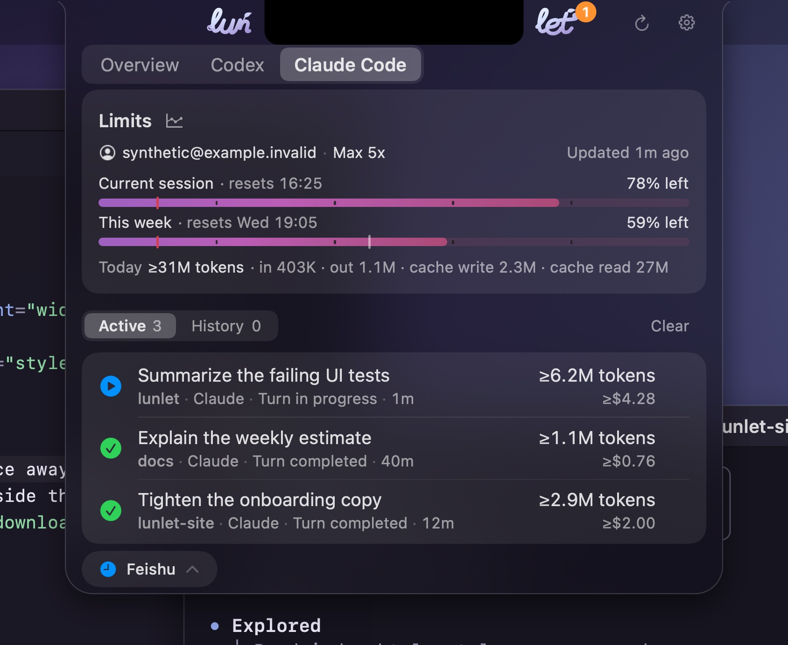

# Lunlet

**A quiet companion for your coding agents, right at the notch.**

Lunlet lives around your MacBook's notch and keeps the Codex and Claude Code work already running on your Mac in view: what each session is doing, how much of each plan is left, and how many tokens you have used. When you lock the Mac and step away, it can send a short completion notice to your own Feishu/Lark, Slack or Telegram bot.

<p align="center">
  
</p>

<p align="center">
  
  
  
</p>

<p align="center"><sub>Every picture is rendered from Lunlet's own interface with synthetic data by <code>scripts/render-site-assets.sh</code>. <a href="website/video/lunlet-walkthrough.mp4">Watch the one-minute walkthrough</a>, rendered from Lunlet's own views with synthetic data, captions included.</sub></p>

> **Status: unsigned preview.** Download the disk image from the [latest GitHub Release](https://github.com/yukunlabs/lunlet/releases/latest) or build from source as shown below. The download is signed ad hoc and not notarized, so macOS asks you to allow it once: on macOS 15 and later, open it, choose Done, then System Settings › Privacy & Security › Open Anyway; on macOS 14, right-click Lunlet and choose Open. Updates install from inside Lunlet and ask for nothing. Codex and Claude Code observation, limits and usage work locally. Notices to a locked Mac's paired Feishu, Telegram or Slack chat, and one reply per notice that continues the same Codex session, are verified on the maintainer's devices. Feishu cards have not yet been reviewed in the phone app, Claude Code sessions take no replies, and an in-app update from the first version is accepted when the second one ships.

## Features

- **At the notch.** "lun" and "let" sit beside the notch, joined by one vine strand per agent that shows how much of its weekly allowance is left. Hover to preview the panel, click to keep it open. Macs without a notch can use a menu-bar entry instead.
- **Sessions at a glance.** Active and History lists for local Codex sessions (CLI, Codex App, editors) and Claude Code sessions, with each session's latest prompt, status and tokens. A short island at the notch tells you when a turn starts or finishes; open the panel right after and it shows that conversation.
- **Limits and usage.** Codex weekly allowance, credits and reset credits. Claude Code's five-hour and weekly limits through a status line Lunlet adds to Claude Code automatically (turning Claude Code off in Settings restores your previous one exactly). A weekly trend estimates when you might run out. Daily token usage per agent, with a cost figure that is an API-price estimate, never your bill.
- **While you are away.** While the Mac is locked and awake, each finished turn reaches the bot and private chat you paired, on Feishu or Lark, Slack or Telegram, with its outcome, your request and the agent's reply. A Codex notice takes one reply: from the Feishu card's reply box, Telegram's Reply button or the Slack thread, your reply continues that same session as its next turn, never a new one, once, within ten minutes and while the Mac stays locked. The notice is then rewritten in place with the reply's progress: received, sent, delivered, or why it was not sent. Execution approvals stay on your Mac.
- **Make it yours.** Vine and Lantern skins in any color, declarative custom skins, light and dark appearance.

## Requirements

- macOS 14 or later on Apple silicon (the download is arm64 only). Tested on macOS 27; a notched MacBook gives the full experience.
- Codex (CLI or app) and/or Claude Code, signed in on this Mac.
- To build: Xcode Command Line Tools with Swift 6.2 or later.

## Install

Download `Lunlet-<version>-macos-arm64.dmg` from the [latest release](https://github.com/yukunlabs/lunlet/releases/latest), open it and drag Lunlet to Applications. Each release lists its files' SHA-256 checksums, its source tag and, in `manifest.json`, its signing and notarization status. The first time you open it, macOS asks you to allow it as described above. Release notes live in [docs/release-notes](docs/release-notes).

## Build and run

From a checkout of this repository:

```sh
scripts/build-app.sh --preview
open .tmp/Lunlet.app
```

`--preview` produces an ad hoc–signed build for your own Mac. The downloadable preview is also signed ad hoc, so macOS asks to allow it on first open; updates ask for nothing, because your bot connection is kept in a file only your user can read rather than in the Keychain. A Developer ID-signed, notarized release is a later step. See [release preparation](docs/releases.md). To connect a messaging bot, follow [messaging setup](docs/messaging.md).

## Privacy

- Lunlet runs on your Mac and has no servers, analytics or telemetry of its own.
- It reads Codex's and Claude Code's local session records and transcripts to show activity and usage, including your latest request and the agent's final reply for each finished turn.
- A completion notice, sent only while the Mac is locked and a bot is paired, goes through that messaging provider to your private chat. It carries the project, agent and session title, an excerpt of your latest request (about 140 characters) and the agent's final reply, shortened only to fit the messenger. Secret-looking values and hidden reasoning are removed and home folders shortened, but no filter catches everything; tool output and the rest of the conversation are never sent.
- Codex limits come from Codex's own account interface on this Mac. Claude Code limits come only from Lunlet's status line in Claude Code, added while Claude Code is selected and removed, restoring your previous one, when you turn Claude Code off; the account email and plan come from Claude Code's local profile. Lunlet never reads Claude Code login credentials.
- A reply from Feishu, Slack or Telegram is passed to that session's own Codex with `codex queue` and only after Lunlet confirms the session is still open and idle; the session keeps its sandbox and approval settings. The reply text is briefly visible to your other processes as a command argument.
- Messaging credentials are stored on your Mac in `~/Library/Application Support/com.lunlet/credentials`, in files only your user account can read, sealed with a key bound to this Mac and your account (not in the Keychain, so updates never ask for authorization). A copy of a file on another Mac or account cannot be opened, and a backup or disk scan shows no token; a program running as you could still read them, as it could read Codex's own credential file. Moving to a new Mac means connecting the channel again.
- Errors are also kept in a small local log at `~/Library/Logs/Lunlet` (no content or identifiers, at most 256 KB, never uploaded); Settings › About shows it in Finder.
- Release builds check for updates about once a day with [Sparkle](https://sparkle-project.org); the request identifies only Lunlet's and Sparkle's versions, with no system profile, and nothing is downloaded until you choose Install. Turn the checks off in Settings › About. `--preview` builds never check.

## Not yet available

- Replies to Claude Code sessions, and answering an agent's question from your phone.
- A notarized download: the current one is an unsigned preview that macOS asks you to allow on first open; a Developer ID-signed, notarized release comes later. Intel Macs. Feishu cards reviewed in the phone app.
- Linux, Cursor and other agents.

## Development

Lunlet is a Swift package (SwiftUI and AppKit) with separate modules for the core, Codex, Claude Code, Feishu, messaging, secure storage and the desktop app.

```sh
scripts/test-core.sh all                      # default suite
scripts/test-core.sh desktop                  # one module: core, codex, claude, feishu, messaging, storage, desktop
LUNLET_TEST_PANEL=1 scripts/test-core.sh --filter PanelPlacementTests   # native window checks
python3 scripts/check_traceability.py         # story references, licensing headers, language
```

Every change traces to a confirmed user story in [the requirements](docs/requirements.md). Start with [Contributing](CONTRIBUTING.md); repository conventions are in [AGENTS.md](AGENTS.md). To follow diagnostics, which carry no content or identifiers, run `log stream --style compact --predicate 'subsystem == "com.lunlet"'`.

## Documentation

- [Requirements](docs/requirements.md): user stories, acceptance criteria and release scope.
- [Feasibility](docs/feasibility.md): technical evidence and open validation gates.
- [Messaging setup](docs/messaging.md) and [custom skins](docs/skins.md).
- [Release preparation](docs/releases.md): packaging, signing, the product page and how releases are iterated.
- [Product page](https://yukunlabs.github.io/lunlet/) with the one-minute walkthrough.
- [Contributing](CONTRIBUTING.md), [code of conduct](CODE_OF_CONDUCT.md) and [security policy](SECURITY.md).

## License

[0BSD](LICENSE): free for everyone to use, copy, modify and distribute. Third-party notices are in [NOTICE.md](NOTICE.md).

Codex, Claude, Feishu, Lark, Slack and Telegram are trademarks of their respective owners. Lunlet is an independent project and is not affiliated with or endorsed by them.
