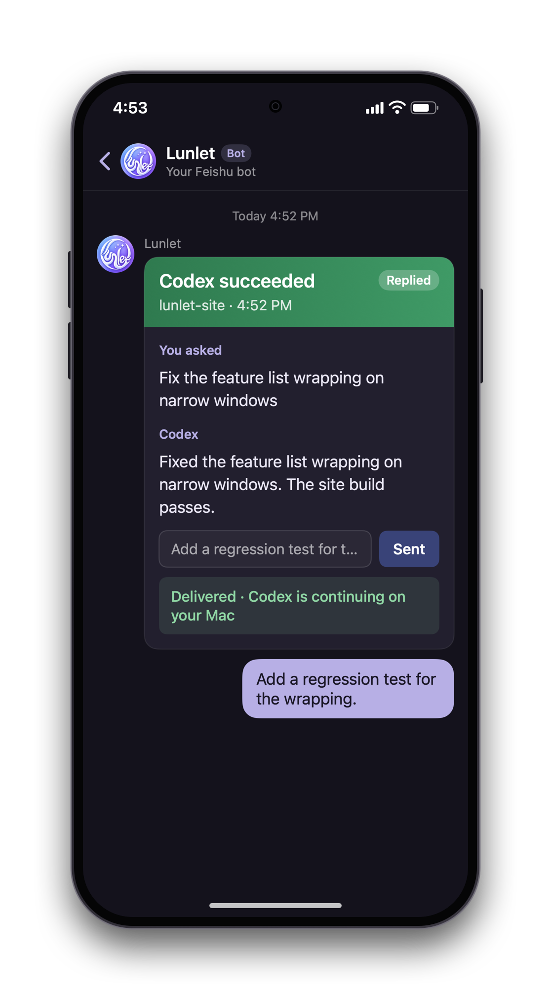

<h1 align="center">Lunlet</h1>

<p align="center">Codex and Claude Code, at your Mac's notch.</p>

<p align="center">
  <strong>English</strong> · <a href="README.zh-CN.md">&#x7B80;&#x4F53;&#x4E2D;&#x6587;</a> · <a href="README.ja.md">&#x65E5;&#x672C;&#x8A9E;</a>
</p>

<p align="center">
  <a href="https://github.com/yukunlabs/lunlet/releases/latest"></a>
  
  <a href="LICENSE"></a>
</p>

<p align="center">
  
</p>

Lunlet sits beside the notch and shows what your coding agents are doing and how much of your plan is left. When you lock the Mac and walk away, it messages your phone as each turn finishes, and one reply keeps that session going.

It runs on your Mac, with no server, analytics or telemetry of its own. [Watch the one-minute walkthrough](https://yukunlabs.github.io/lunlet/#film).

<sub>Pictures and the walkthrough are rendered from Lunlet's own interface with synthetic data.</sub>

## Features

### Sessions

<p align="center">
  
</p>

Every local Codex and Claude Code session in one list, whichever terminal or editor it runs in, with its latest prompt, status and tokens. A small island appears at the notch when a turn starts or finishes.

### Limits and usage

<p align="center">
  
  
</p>

Each agent's weekly limit is drawn beside the notch. The panel adds Codex's five-hour window and credits, an estimate of when you might run out, and daily token usage with a cost estimated at API prices.

### Phone notices

<p align="center">
  
  
  
</p>

While the Mac is locked, each finished turn goes to your own Feishu (Lark), Slack or Telegram bot. Reply once from the phone and the same session continues. Approvals stay on the Mac. See [messaging setup](docs/messaging.md).

### More

- No notch? Use the menu-bar entry or a small desktop pet.
- Recolor the Vine and Lantern skins, or [write your own](docs/skins.md).

## Install

1. Download `Lunlet-<version>-macos-arm64.dmg` from the [latest release](https://github.com/yukunlabs/lunlet/releases/latest), open it and drag Lunlet to Applications.
2. Open Lunlet. It is an unsigned preview, so macOS asks you to allow it once. On macOS 15 or later, choose Done, then choose Open Anyway in System Settings › Privacy & Security. On macOS 14, right-click Lunlet and choose Open.
3. Hover "lun" and "let" beside the notch to preview the panel, or click to keep it open.

Lunlet needs macOS 14 or later on Apple silicon, and Codex or Claude Code signed in on this Mac. Updates install from inside Lunlet.

## Privacy

- Lunlet runs on your Mac and has no servers, analytics or telemetry of its own.
- It reads Codex's and Claude Code's local session records to show activity and usage. It never reads Claude Code login credentials.
- While Claude Code is selected, Lunlet adds a status line and one Stop hook to Claude Code's user settings. Turning Claude Code off removes the hook and restores your previous status line.
- A notice is sent only while the Mac is locked and a bot is paired. It goes through that messenger to your private chat and carries the project, the session title, a short excerpt of your request and the agent's final reply.
- Bot tokens stay on your Mac, in files only your user account can read.

The full statement is in [docs/privacy.md](docs/privacy.md).

## Status

Lunlet is an early, unsigned preview. Not available yet: answering an agent's question from the phone, a notarized download, Intel Macs, Linux, and agents other than Codex and Claude Code. What has been verified so far is recorded in [docs/feasibility.md](docs/feasibility.md).

## Build from source

```sh
scripts/build-app.sh --preview
open .tmp/Lunlet.app
```

You need Xcode Command Line Tools with Swift 6.2 or later. To contribute, start with [CONTRIBUTING.md](CONTRIBUTING.md).

## Documentation

- [Messaging setup](docs/messaging.md) and [custom skins](docs/skins.md)
- [Privacy](docs/privacy.md) and [security policy](SECURITY.md)
- [Requirements](docs/requirements.md), [feasibility](docs/feasibility.md) and [releases](docs/releases.md)
- [Product page](https://yukunlabs.github.io/lunlet/)

## License

[0BSD](LICENSE). Third-party notices are in [NOTICE.md](NOTICE.md).

Codex, Claude, Feishu, Lark, Slack and Telegram are trademarks of their respective owners. Lunlet is an independent project and is not affiliated with or endorsed by them.
