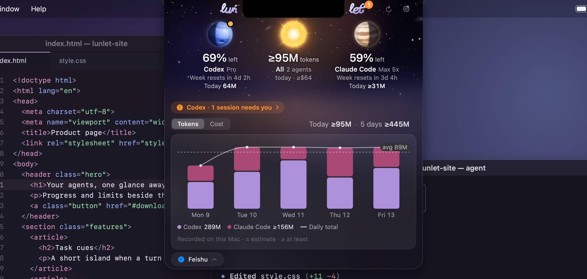
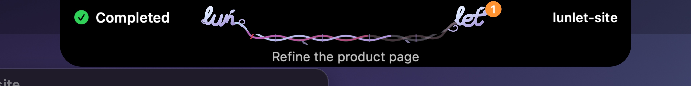
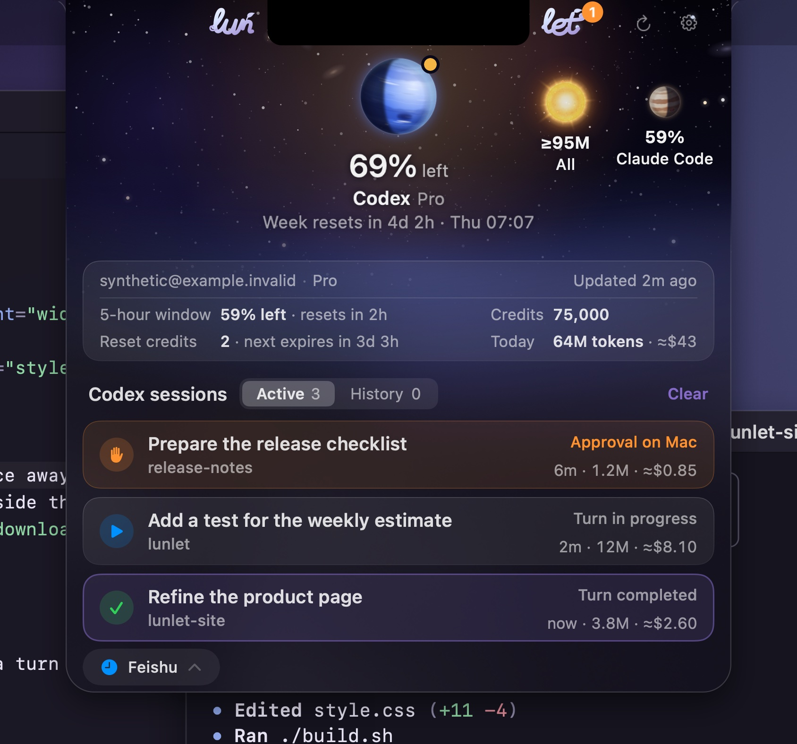
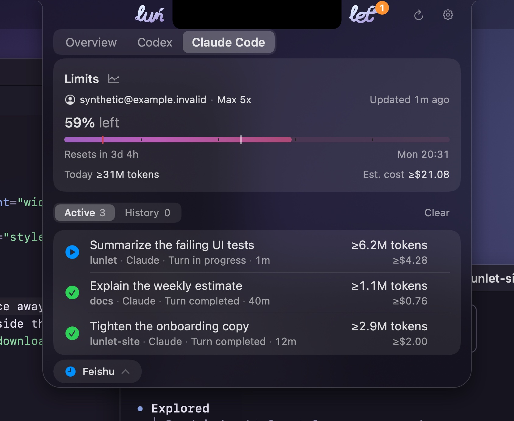
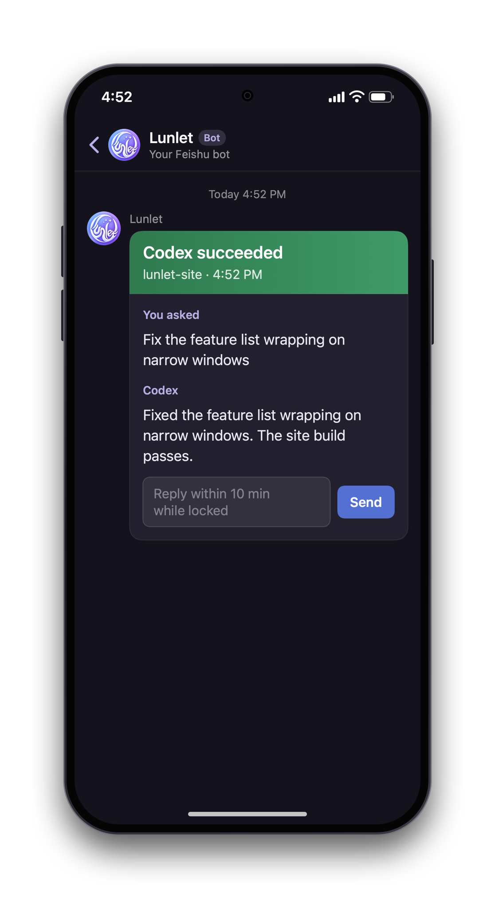
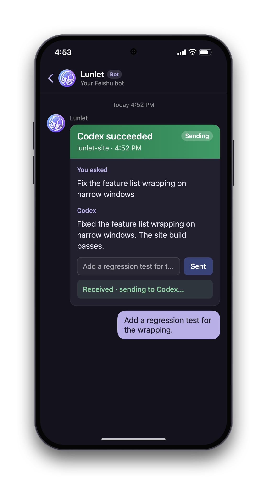
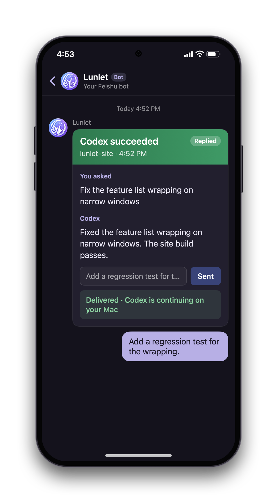

<h1 align="center">Lunlet</h1>

<p align="center">Codex 与 Claude Code，抬眼可见。</p>

<p align="center">
  <a href="README.md">English</a> · <strong>简体中文</strong> · <a href="README.ja.md">日本語</a>
</p>

<p align="center">
  <a href="https://github.com/yukunlabs/lunlet/releases/latest"></a>
  
  <a href="LICENSE"></a>
</p>

<p align="center">
  
</p>

Lunlet 常驻刘海两侧，编码 Agent 进展如何、套餐额度还剩多少，一目了然。锁屏离开后，每一轮任务的结果都会推送到手机；回复一句，原会话随即继续。

Lunlet 完全在本机运行，没有自己的服务器，不做统计，也不采集遥测数据。[观看一分钟演示](https://yukunlabs.github.io/lunlet/#film)。

<sub>文中图片与演示视频均由 Lunlet 的真实界面配合模拟数据渲染而成。</sub>

## 功能

### 会话

<p align="center">
  
</p>

本机所有 Codex 与 Claude Code 会话汇于一处，无论运行在哪个终端或编辑器，最近的指令、当前状态与 token 用量都清晰可见。每一轮任务开始或结束时，刘海下方会浮现一座小岛，提示进展。

### 额度与用量

<p align="center">
  
  
</p>

各 Agent 的每周额度就绘在刘海两侧，余量一望即知。展开面板，还可查看 Codex 的 5 小时窗口与 credits、额度预计何时用尽，以及每日 token 用量和按 API 价格折算的费用。

### 手机通知

<p align="center">
  
  
  
</p>

Mac 锁屏期间，每一轮任务的结果都会推送到你自己的飞书（Lark）、Slack 或 Telegram 机器人。在手机上回复一次，原会话便会继续。执行审批始终留在 Mac 上。配置方法见[消息通道设置](docs/messaging.md)（英文）。

### 更多

- 没有刘海也无妨：可改用菜单栏入口，或一只桌面小宠物。
- Vine 与 Lantern 两款皮肤可自由换色，也可以[自己设计一套](docs/skins.md)（英文）。

## 安装

1. 在[最新版本](https://github.com/yukunlabs/lunlet/releases/latest)中下载 `Lunlet-<version>-macos-arm64.dmg`，打开后将 Lunlet 拖入“应用程序”。
2. 打开 Lunlet。当前为未签名的预览版，首次打开需要手动放行一次。macOS 15 及以上：在弹窗中点按“完成”，再前往“系统设置 › 隐私与安全性”，点按“仍要打开”。macOS 14：右键点按 Lunlet，选择“打开”。
3. 将指针悬停在刘海两侧的“lun”与“let”上即可预览面板，点按则保持展开。

需要搭载 Apple 芯片的 Mac 与 macOS 14 或更高版本，并已在本机登录 Codex 或 Claude Code。后续更新可在 Lunlet 内直接完成。

## 隐私

- Lunlet 在本机运行，没有自己的服务器，不做统计，也不采集遥测数据。
- 它读取 Codex 与 Claude Code 保存在本机的会话记录，用于呈现活动与用量；绝不读取 Claude Code 的登录凭据。
- 启用 Claude Code 期间，Lunlet 会在其用户设置中添加一个状态栏和一条 Stop hook；停用后，hook 即被移除，原有状态栏随之恢复。
- 仅当 Mac 已锁屏且已配对机器人时，才会发出通知。通知经由所选消息平台送达你的私聊，内容包括项目、会话标题、请求的简短摘录，以及 Agent 的最终回复。
- 机器人 token 仅保存在本机，且只有你的用户账户可以读取。

完整说明见 [docs/privacy.md](docs/privacy.md)（英文）。

## 状态

Lunlet 尚处早期，目前为未签名的预览版。暂不支持：在手机上回答 Agent 的提问、经过公证的安装包、Intel Mac、Linux，以及 Codex 与 Claude Code 之外的 Agent。已验证的内容记录于 [docs/feasibility.md](docs/feasibility.md)（英文）。

## 从源码构建

```sh
scripts/build-app.sh --preview
open .tmp/Lunlet.app
```

需要 Xcode Command Line Tools 与 Swift 6.2 或更高版本。如想参与贡献，请先阅读 [CONTRIBUTING.md](CONTRIBUTING.md)（英文）。

## 文档

- [消息通道设置](docs/messaging.md)与[自定义皮肤](docs/skins.md)
- [隐私](docs/privacy.md)与[安全策略](SECURITY.md)
- [需求](docs/requirements.md)、[可行性验证](docs/feasibility.md)与[发布流程](docs/releases.md)
- [产品页](https://yukunlabs.github.io/lunlet/)

以上文档目前仅提供英文版。

## 许可

[0BSD](LICENSE)。第三方声明见 [NOTICE.md](NOTICE.md)。

Codex、Claude、Feishu、Lark、Slack 与 Telegram 均为其各自所有者的商标。Lunlet 是独立项目，与上述各方并无关联，亦未获其认可。
